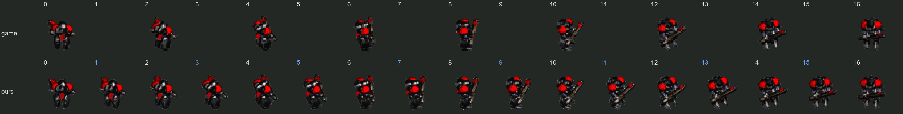
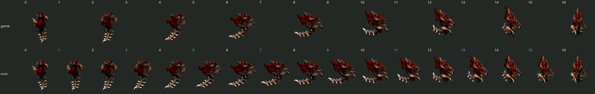
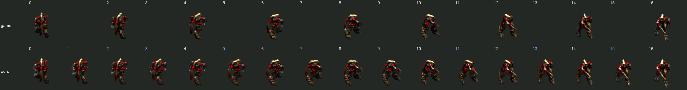

# glisomorph

**Gli**ssando + **Isom**etric + **Morph**

Just as a **gl**issando glides between two musical notes, **iso**metric sprites can **morph**
smoothly between two frames. glisomorph synthesizes the frames in between, along two axes:

- **Time**: between consecutive animation frames, for smoother motion.
- **Space**: between adjacent facing directions, e.g. turning 8 directions into 16.

```text
direction ↓   time →
              f0      f1      f2
  S           ■   □   ■   □   ■
              □   □   □   □   □
  SW          ■   □   ■   □   ■
              □   □   □   □   □
  W           ■   □   ■   □   ■

  ■ original frame    □ interpolated frame
```

## Status

A proof of concept for Diablo 1, in [`poc/`](poc/README.md) (Python, PyTorch, gsplat). For each sprite, it:

1. **Reconstructs** the model in 3D from its 8 directions: as voxels, or as 3D Gaussians. An
   animation gets one set of Gaussians, moved from frame to frame.
2. **Renders** the new directions and frames from that reconstruction.
3. **Copies the artist's pixels** into them: each new pixel takes its palette index from the
   originals that see the same surface point, relit, so the output stays in the game's palette.
4. **Adds the baked shadow** the way the originals were made: the outline, squashed and sheared.

The game data readers are in `blizzard_common` (MPQ archives), `diablo1` (palettes, CL2
sprites) and `starcraft` (GRP sprites). Results and open problems are in [poc/README.md](poc/README.md).

The frames it makes are written out by exporters that share one interface ([common/docs/AGENTS.md](common/docs/AGENTS.md)).
The previews are in `common/export`: a comparison with the game's frames, a file per animation, and a demo
that turns through every direction, each as GIF, APNG or WebP. The game's own formats are with their game:
StarCraft's GRP in `starcraft/export`, Diablo's CL2 in `diablo1/export`.

## Examples

<details>
<summary>StarCraft</summary>

StarCraft draws 17 of a unit's 32 directions and mirrors the rest. Some units, among them the marine,
hydralisk and zealot, draw only every other one of those 17. Here glisomorph fills in the 8 they skip
and the frames between the game's, at 4× the resolution: three walk cycles, then an attack.

- **Top row:** the game's own frames, each pixel a 4×4 block, above their direction numbers.
- **Bottom row:** glisomorph's, in all 17 directions (the new ones numbered in blue) at twice the frame
  rate. Every one is drawn from a 3D model fitted to the game's frames, in the game's palette.

They play at about the game's Normal speed. They were made with the [proof of concept](poc/README.md),
through a StarCraft adapter that isn't in the repo.

**Marine**



**Hydralisk**



**Zealot**: the game draws its psi blades as flat swooshes that change shape every frame, which the 3D
model can't follow. So they're drawn apart from the body, at 1× and scaled up as pixel art: the game's
own pixels in the directions it draws, and elsewhere the blades of each frame fitted on its own.



</details>
